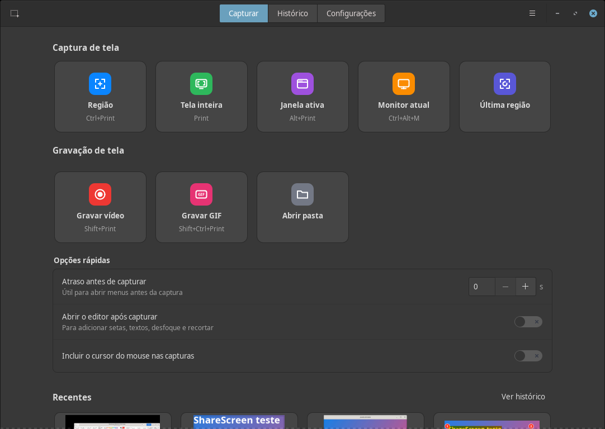
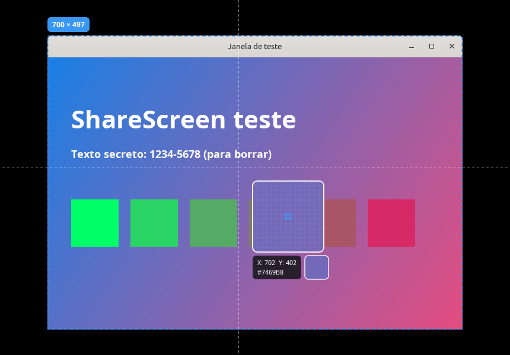
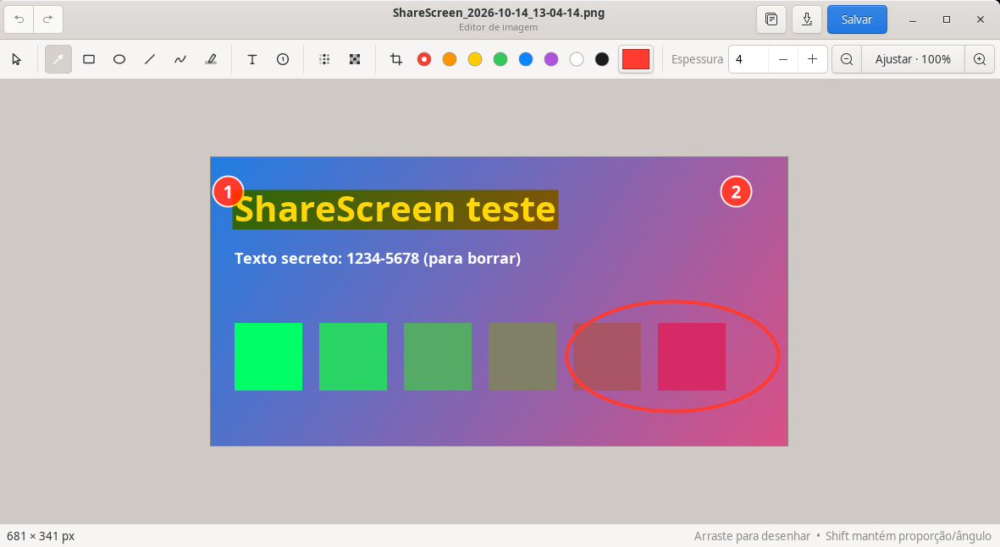
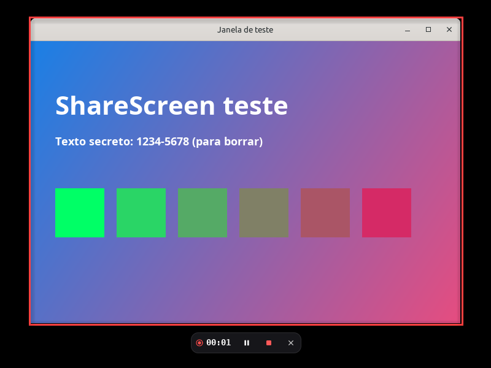
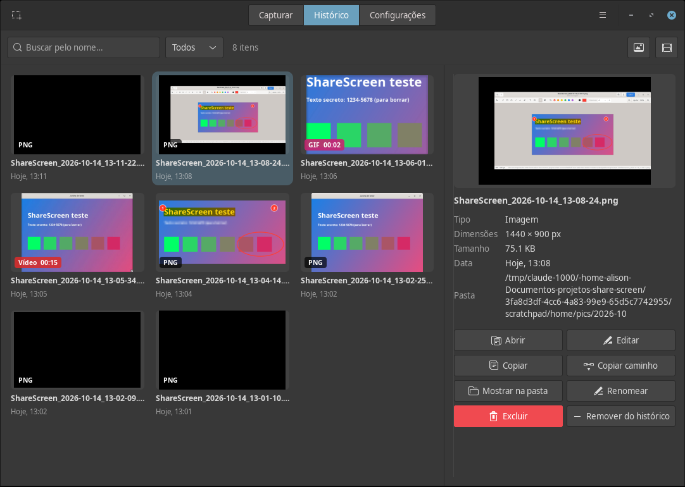

# ShareScreen

Captura de tela e gravação para Linux, no estilo do ShareX. Fica na bandeja do
sistema, responde a atalhos globais e guarda tudo localmente.

Feito e testado no **Linux Mint 22 (Cinnamon, X11)**. Deve funcionar igual em
outras distros com X11 e base Debian/Ubuntu (MATE, Xfce, Cinnamon). Em sessões
Wayland funciona com limitações (veja [Wayland](#wayland)).



| Seleção de região | Editor |
| --- | --- |
|  |  |

| Gravação | Histórico |
| --- | --- |
|  |  |

## Recursos

**Captura de imagem**
- Região: arraste para selecionar ou clique numa janela/monitor para capturá-lo
  inteiro (detecção automática de janelas, com lupa, coordenadas e cor do pixel)
- Tela inteira (todos os monitores), monitor atual, janela ativa e última região
- Atraso configurável com contagem regressiva; cursor do mouse opcional
- PNG, JPEG ou WebP; nomes e subpastas por data configuráveis

**Gravação**
- Vídeo MP4 (H.264), WebM (VP9) ou MKV, com som do computador e/ou microfone
- GIF otimizado (paleta própria, FPS e largura máxima configuráveis)
- Borda ao redor da área (fica do lado de fora, não aparece no vídeo)
- Barra de controle com tempo, **pausar/continuar**, parar e cancelar
- Contagem regressiva antes de começar
- Ao terminar, o vídeo/GIF vai para a área de transferência como arquivo: é só
  `Ctrl+V` no Telegram, Discord, WhatsApp Web, navegador ou numa pasta

**Editor de imagem**
- Seta, retângulo, elipse, linha, caneta, marca-texto, texto, numeração automática
- Desfocar e pixelizar (para esconder dados sensíveis), recortar
- Mover/apagar anotações, desfazer/refazer, zoom, cores e espessura

**Após a captura** (configurável): salvar, copiar imagem ou caminho, abrir no
editor, notificar (com botões Editar / Mostrar na pasta) e abrir o arquivo.

**Janela principal**: botões de captura, histórico com miniaturas, busca e filtros
(abrir, editar, copiar, renomear, mostrar na pasta, enviar para a lixeira) e
todas as configurações.

## Instalação

### Opção 1 — instalador (recomendado)

```bash
git clone https://github.com/Alison4kk/screenshare.git
cd screenshare
./install.sh
```

Para atualizar depois: `git pull && ./install.sh`.

Instala só para o seu usuário (em `~/.local`). Se faltar alguma dependência, ele
oferece instalar via `apt`. Depois é só abrir o **ShareScreen** pelo menu.

### Opção 2 — pacote .deb

Baixe o `.deb` na página de [Releases](https://github.com/Alison4kk/screenshare/releases)
e instale com duplo clique, ou gere você mesmo a partir do código:

```bash
./packaging/build-deb.sh
sudo apt install ./dist/sharescreen_1.0.1_all.deb
```

### Opção 3 — rodar direto da pasta

```bash
python3 run.py
```

Dependências (já vêm no Linux Mint): `python3-gi python3-gi-cairo gir1.2-gtk-3.0 ffmpeg`.
Recomendadas: `gir1.2-xapp-1.0` (bandeja no Mint), `gir1.2-notify-0.7`, `pulseaudio-utils`.

## Atalhos padrão

| Atalho | Ação |
| --- | --- |
| `Print` | Capturar tela inteira |
| `Ctrl+Print` | Capturar região |
| `Alt+Print` | Capturar janela ativa |
| `Shift+Print` | Gravar vídeo (pressione de novo para parar) |
| `Ctrl+Shift+Print` | Gravar GIF (pressione de novo para parar) |

Todos podem ser alterados em **Configurações → Atalhos**.

O Cinnamon já usa essas teclas para a ferramenta de captura dele. Na primeira
execução, o ShareScreen pergunta se pode liberá-las. Dá para fazer isso
depois em **Configurações → Atalhos → Liberar atalhos** e desfazer a qualquer
momento com **Restaurar**.

Na seleção de região: arraste para selecionar, clique para pegar a janela sob o
cursor, `Enter` captura o que está destacado, setas movem o cursor 1 px
(`Shift` = 10 px) e `Esc` ou botão direito cancelam.

No editor: `Ctrl+Z`/`Ctrl+Y` desfazer/refazer, `Ctrl+C` copiar, `Ctrl+S` salvar,
`Delete` apaga a anotação selecionada, `Ctrl+roda do mouse` dá zoom e as letras
`V A R E L P H T N B X C` trocam de ferramenta.

## Linha de comando

```
sharescreen                 abre a janela (ou traz para frente)
sharescreen --region        captura uma região
sharescreen --fullscreen    captura a tela inteira
sharescreen --window        captura a janela ativa
sharescreen --monitor       captura o monitor onde está o mouse
sharescreen --last-region   repete a última região
sharescreen --record        inicia/para gravação de vídeo
sharescreen --record-gif    inicia/para gravação de GIF
sharescreen --stop          para a gravação
sharescreen --delay 3 ...   espera 3 s antes de capturar
sharescreen --background    inicia só na bandeja
sharescreen --quit          encerra
```

Se já houver uma instância rodando, o comando é repassado para ela.

## Onde ficam os arquivos

- Capturas: `~/Imagens/ShareScreen/AAAA-MM/`
- Gravações: `~/Vídeos/ShareScreen/AAAA-MM/`
- Configurações: `~/.config/sharescreen/config.json`
- Histórico: `~/.local/share/sharescreen/history.json`
- Miniaturas: `~/.cache/sharescreen/`

## Wayland

Em sessões Wayland (Ubuntu e Fedora recentes, por exemplo), o sistema não
permite capturar a tela nem registrar atalhos globais diretamente. Nesses casos,
o ShareScreen usa o portal do sistema (xdg-desktop-portal):

- capturas funcionam (a seleção de região usa a imagem obtida pelo portal);
- a gravação grava o monitor/janela escolhido no diálogo do sistema (precisa de
  `gstreamer1.0-pipewire`); seleção de região e pausa não ficam disponíveis;
- crie atalhos nas configurações de teclado do sistema usando os comandos acima.

O Linux Mint usa X11 por padrão, onde tudo funciona sem restrições.

## Solução de problemas

- **Um atalho aparece com aviso ⚠**: outra aplicação já usa a combinação.
  Use "Liberar atalhos" (se for do sistema) ou escolha outra tecla.
- **Não aparece ícone na bandeja**: instale `gir1.2-xapp-1.0` (Mint/MATE/Xfce)
  ou `gir1.2-ayatanaappindicator3-0.1` (+ extensão AppIndicator no GNOME).
- **Gravação sem som**: confira em Configurações → Gravação → Áudio. Se o áudio
  falhar, a gravação continua só com vídeo e você é avisado.
- **Rodar pelo terminal para ver mensagens de erro**: `sharescreen` ou `python3 run.py`.

## Estrutura do projeto

```
sharescreen/
  app.py          aplicativo: bandeja, atalhos, fluxo de captura e linha de comando
  capture.py      captura da tela, monitores, janela ativa e cursor
  overlay.py      sobreposição de seleção de região (lupa, mira, detecção de janelas)
  recorder.py     gravação (ffmpeg no X11; portal + GStreamer no Wayland)
  editor.py       editor de imagem
  hotkeys.py      atalhos globais (XGrabKey)
  x11.py          bindings ctypes mínimos de Xlib/XFixes
  portal.py       xdg-desktop-portal (Wayland)
  desktop.py      autostart e conflitos com atalhos do sistema
  history.py      histórico e miniaturas
  ui/             janela principal (Capturar, Histórico, Configurações)
  data/           ícones e CSS
packaging/        .desktop e gerador do .deb
```

Para desenvolver ao lado da versão instalada, use outro ID de aplicativo:
`SHARESCREEN_APP_ID=io.github.sharescreen.dev python3 run.py`.

## Desinstalar

```bash
./uninstall.sh
```

Remove o app e devolve ao sistema os atalhos que tenham sido liberados. Suas
capturas não são apagadas.
